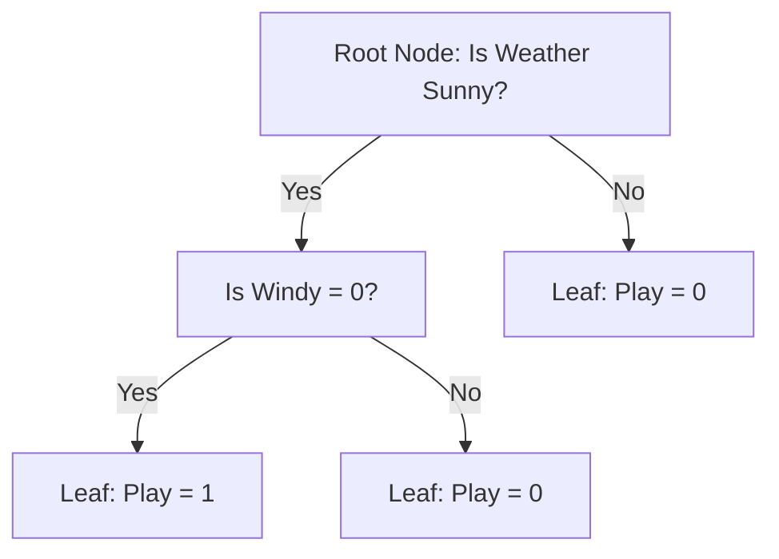

# Decision Trees: Fundamentals, Pruning, and Model Evaluation

This folder documents my learning and practical exercises on **Decision Trees**, a supervised machine learning algorithm that makes predictions by repeatedly splitting data according to feature-based rules. The module focuses on how a classification tree is structured, how it selects useful splits, why overfitting happens, and how to evaluate predictions beyond accuracy alone.

I explored these concepts through a single Jupyter notebook containing three synthetic datasets and several classification experiments. The datasets are for learning purposes; the healthcare-themed example does **not** use real patient records.

## Topics Covered

### 1. Introduction to Decision Trees

A decision tree makes predictions by following a sequence of questions, similar to a flowchart. Each question divides observations into smaller groups until the model reaches a prediction.

The main components are:

- **Root node:** The first decision point, where all observations enter the tree.
- **Internal nodes:** Additional questions that divide the data into smaller groups.
- **Branches:** The possible outcomes of each question.
- **Leaf nodes:** The final nodes that provide predictions.

Decision trees are useful because their rules are relatively easy to visualize and interpret. They can represent nonlinear relationships and generally do not require feature scaling. However, individual trees can be unstable and are prone to overfitting when they grow too complex.

### 2. A Simple Tree Visualization

A Decision Tree is easiest to understand when seen as a sequence of questions. A simplified version of the small **Play Cricket** example can be visualized like this:



This tree can be read from top to bottom:

- Start at the **root node**.
- Follow the branch that matches the observation.
- Keep answering questions until reaching a **leaf node**.
- The **leaf node** gives the final prediction.

For example:

- If **Weather = Sunny** and **Windy = 0**, the model predicts **Play = 1**.
- If **Weather = Rainy**, the model directly predicts **Play = 0**.
- If **Weather = Sunny** and **Windy = 1**, the model predicts **Play = 0**.

This is the core idea of Decision Trees: the model breaks a problem into smaller, simpler yes/no decisions.

### 3. Entropy, Gini Index, and Information Gain

A decision tree needs a way to decide which feature and split point to use. It evaluates potential splits by asking how effectively they separate observations into groups with similar class labels.

- **Impurity:** Describes how mixed the class labels are within a node. A node containing only one class is pure.
- **Entropy:** Measures uncertainty or disorder in a group. It is higher for mixed classes and becomes zero in a pure node.
- **Gini Index:** Measures impurity through the chance of assigning an incorrect class when labels are drawn according to the group's class distribution. It also reaches zero for a pure node.
- **Information Gain:** Measures how much impurity is reduced by a split.

#### Entropy

For a binary classification node with class probabilities `p` and `1-p`, entropy is:

$$
Entropy = -p \log_2(p) - (1-p) \log_2(1-p)
$$

Intuition:

- If all examples belong to one class, entropy = **0**.
- If the classes are evenly mixed, entropy is highest.

Example:

If a node contains **6 Yes** and **4 No**, then:

$$
p(Yes)=0.6, \quad p(No)=0.4
$$

$$
Entropy = -(0.6)\log_2(0.6) - (0.4)\log_2(0.4) \approx 0.971
$$

This indicates that the node is mixed and still uncertain.

#### Gini Index

Another common impurity measure is:

$$
Gini = 1 - \sum p_i^2
$$

For a binary class case:

$$
Gini = 1 - (p^2 + (1-p)^2)
$$

Using the same example:

$$
Gini = 1 - (0.6^2 + 0.4^2) = 1 - (0.36 + 0.16) = 0.48
$$

A lower Gini value indicates a purer node.

#### Information Gain

Conceptually, information gain is calculated as:

$$
\text{Information Gain} = \text{Parent Impurity} - \text{Weighted Children Impurity}
$$

A useful split reduces impurity and creates more homogeneous child nodes. The theory slides illustrate this with a parent group of **6 Yes and 4 No**, separated into **5 Yes and 0 No** on one side and **1 Yes and 4 No** on the other.

The Decision Tree chooses the split with the **highest information gain** or, equivalently, the split that produces the **largest impurity reduction**.

### 4. Building and Visualizing a Decision Tree

The first practical exercise uses a small **Play Cricket** dataset with eight observations:

- **`Weather`:** Sunny or Rainy
- **`Windy`:** 0 (No) or 1 (Yes)
- **`Play`:** 0 (Do not play) or 1 (Play)

The notebook converts the categorical `Weather` values into numeric inputs (`Sunny = 1`, `Rainy = 0`) and trains a `DecisionTreeClassifier` with `max_depth=3`.

Using Scikit-learn's `plot_tree`, I explored how the model represents its root, branches, leaves, sample counts, and predicted classes. I also tested individual examples, including a sunny, non-windy day and a rainy, windy day.

**Note:** This small example is fitted on all eight observations to illustrate how a tree works. It is not presented as a held-out evaluation.

### 5. Overfitting and Controlling Tree Complexity

A decision tree with no depth restriction can keep splitting until it captures very specific patterns in the training set. This may improve training accuracy without improving performance on unseen data.

To explore overfitting, the notebook uses `make_classification` to generate **400 synthetic observations with five features**, then creates a **70% training / 30% testing** split.

Two models are compared:

- **Deep tree:** `DecisionTreeClassifier(random_state=42)` with no explicit depth limit.
- **Depth-limited tree:** `DecisionTreeClassifier(max_depth=3, random_state=42)`.

The saved notebook reports:

- **Deep tree:** Training accuracy **1.000**; test accuracy **0.883**.
- **Depth-limited tree:** Training accuracy **0.904**; test accuracy **0.892**.

The unrestricted tree fits the training observations perfectly, but the simpler tree achieves slightly better test accuracy in this experiment. This illustrates the difference between **memorizing training patterns** and **generalizing to unseen observations**.

The course material also introduces `min_samples_split` and `min_samples_leaf` as ways to control tree growth, although the practical comparison specifically uses `max_depth`.

### 6. Evaluating a Decision Tree Classifier

The next exercise uses a **synthetic heart-disease-like dataset**, created with **300 observations** and three input features:

- **`age`:** Age
- **`chol`:** Cholesterol
- **`thalach`:** Maximum heart rate achieved

The target is `0` for the synthetic **No disease** class and `1` for the synthetic **Disease** class. These labels are generated by a rule in the notebook; they are not medical diagnoses.

The data is split into **80% training / 20% testing**, and a `DecisionTreeClassifier(max_depth=4, random_state=42)` is trained.

The module evaluates the classifier using:

- **Confusion matrix:** Shows correct and incorrect predictions for each class.
- **Accuracy:** Proportion of all predictions that are correct.
- **Precision:** Proportion of predicted positives that are actually positive.
- **Recall:** Proportion of actual positives correctly identified.
- **F1-score:** Harmonic mean of precision and recall.

For this example, the positive class is **Disease (1)**. Precision and recall help distinguish false alarms from missed positive cases, which accuracy alone cannot show.

### 7. Classification Thresholds, ROC Curve, and AUC

The final exercise studies model performance across different classification thresholds.

- **Predicted probabilities:** The notebook obtains positive-class scores using `predict_proba(X_test_h)[:, 1]`.
- **Classification threshold:** A cutoff used to turn predicted probabilities into class predictions. Changing it affects false positives and false negatives.
- **True Positive Rate (TPR):** Proportion of actual positives correctly identified; equivalent to recall.
- **False Positive Rate (FPR):** Proportion of actual negatives incorrectly classified as positive.
- **ROC curve:** Plots TPR against FPR across different thresholds.
- **AUC:** Summarizes how well the model ranks positive cases above negative cases across thresholds.

An ROC curve nearer the top-left corner generally indicates stronger class separation. In this exercise, the notebook computes the ROC curve from the Decision Tree's predicted probabilities and compares it with the diagonal random-classifier reference line.

## Practical Notebook

### [`Module_11_Composite_Colab_Notebook.ipynb`](Module_11_Composite_Colab_Notebook.ipynb)

The notebook combines four hands-on sections:

1. **Module 11.3 — Building a Simple Decision Tree:** Create and encode a small weather dataset, train a classifier, visualize the tree, and make sample predictions.
2. **Module 11.4 — Overfitting and Pruning:** Compare an unrestricted tree with a depth-limited tree using training and test accuracy.
3. **Module 11.5 — Classification Evaluation:** Train a tree on synthetic healthcare-themed data and calculate a confusion matrix, accuracy, precision, recall, and F1-score.
4. **Module 11.6 — ROC Curve and AUC:** Extract positive-class probabilities, calculate FPR and TPR, and plot the ROC curve with its AUC.

## Results from the Notebook

### Deep Tree vs. Depth-Limited Tree

- **Deep tree:** Train accuracy = **100.0%**; test accuracy = **88.3%**.
- **Depth-limited tree (`max_depth=3`):** Train accuracy = **90.4%**; test accuracy = **89.2%**.

These figures are from the saved outputs on the 400-sample synthetic classification dataset.

### Synthetic Healthcare-Themed Classification

The notebook reports the following **test-set** results on 60 synthetic observations:

- **Accuracy:** `0.850`
- **Precision (Disease = 1):** `0.903`
- **Recall (Disease = 1):** `0.824`
- **F1-score (Disease = 1):** `0.862`
- **ROC AUC:** `0.925`

The confusion matrix is:

```text
[[23  3]
 [ 6 28]]
```

Rows represent actual classes, and columns represent predicted classes, with class order **0 (No disease)** and **1 (Disease)**. Thus, the model correctly classifies **23** negative and **28** positive examples, while making **3** false-positive and **6** false-negative predictions.

**Interpretation:** The model correctly classifies **51 out of 60** test examples. Its recall of `0.824` also shows that some positive examples are missed. These results demonstrate how multiple evaluation measures reveal different aspects of performance.

**Dataset limitation:** These numbers come from synthetic, rule-generated data. They demonstrate classification and evaluation methods, not real-world medical performance or clinical suitability.

## Tools and Libraries

- Python
- NumPy
- Pandas
- Matplotlib
- Scikit-learn
- Jupyter Notebook / Google Colab

Install the main dependencies with:

```bash
pip install numpy pandas matplotlib scikit-learn notebook
```

To open the notebook locally:

```bash
jupyter notebook
```

Alternatively, open the `.ipynb` file in Google Colab.

## What I Learned

Through this module, I learned how a Decision Tree builds predictions from a hierarchy of feature-based rules and how impurity measures guide the choice of splits. I practiced encoding categorical inputs, fitting and visualizing a classifier, identifying overfitting by comparing training and testing performance, and controlling tree complexity with a depth limit.

I also learned to interpret a confusion matrix and classification metrics, work with predicted probabilities, and use ROC curves and AUC to evaluate class separation across thresholds.

## Scope

This folder focuses on **Decision Tree classification**, including tree structure, split selection, impurity measures, depth-based complexity control, evaluation metrics, and ROC/AUC analysis. The practical experiments use synthetic data and are intended for learning rather than deployment.
