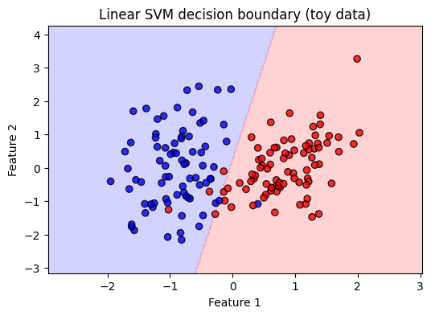
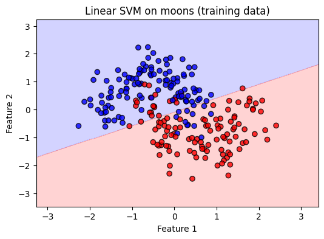
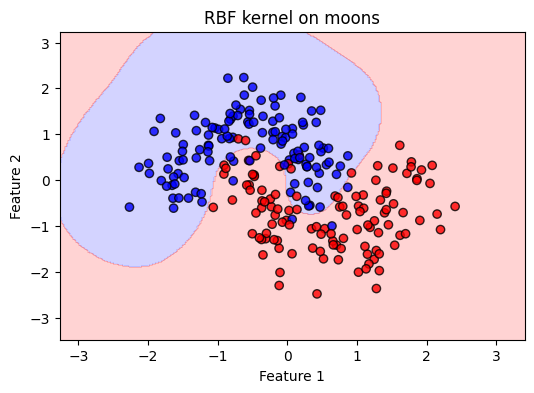
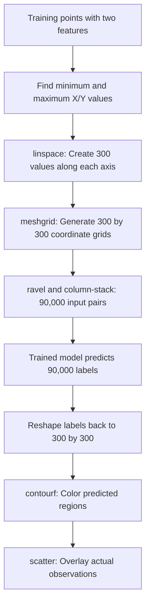
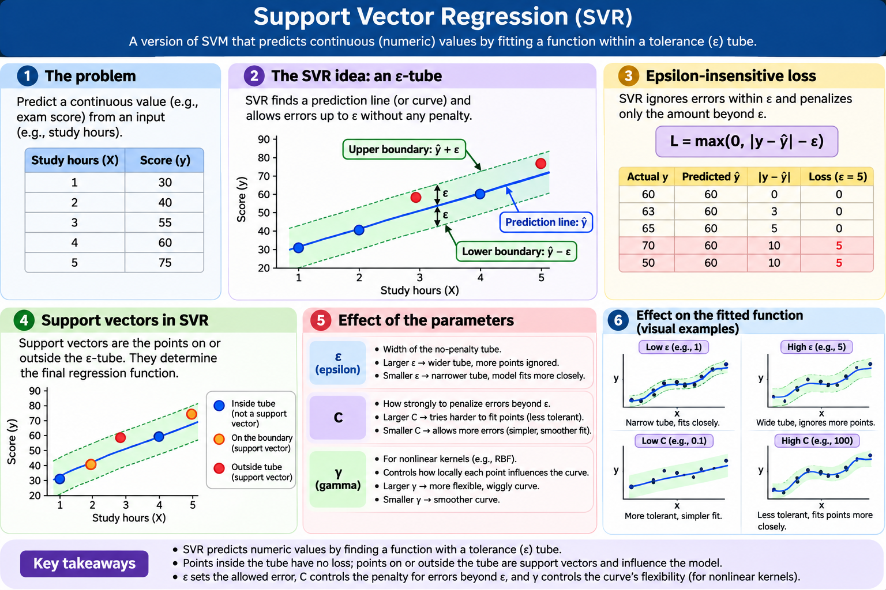
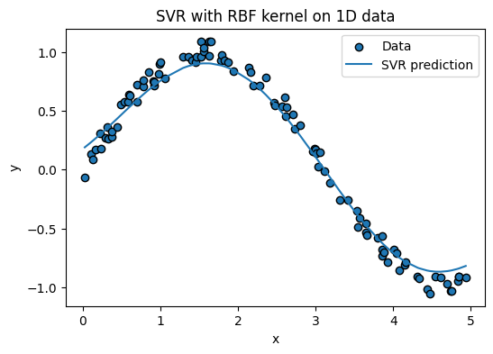

# Support Vector Machines (SVM) and Support Vector Regression (SVR)

## Overview

This module documents my study of **Support Vector Machines (SVM)** for classification and **Support Vector Regression (SVR)** for predicting continuous values. I explored the mathematics behind margins, support vectors, hinge loss, kernels, and hyperparameters, then implemented these ideas with Python and Scikit-learn.

The notebook progresses from **synthetic two-dimensional datasets** to the **Breast Cancer Wisconsin dataset** for classification, then introduces regression using a noisy sine wave and the **Diabetes dataset**.

The goal of this repository section is to connect three questions:

1. **What is the algorithm trying to achieve?**
2. **Why do its mathematical components work?**
3. **How do the implementation and evaluation results reflect those ideas?**

## 1. Support Vector Machine: Core Idea

A **Support Vector Machine (SVM)** is a supervised learning method that classifies observations by finding a decision boundary that separates classes while maintaining a large margin around that boundary.

For two-dimensional data, the decision boundary can be a line. In higher-dimensional data, it is called a **hyperplane**. With kernels, the boundary can also be nonlinear in the original input space.

### Key components

- **Hyperplane:** The boundary used to separate classes.
- **Margin:** The distance from the separating hyperplane to the closest points on either side, in the hard-margin setting.
- **Support vectors:** Training observations that determine the solution. They commonly lie on or inside the margin, or violate it in soft-margin SVM.
- **Kernel:** A similarity function that allows SVM to learn nonlinear decision boundaries.

**Intuition:** SVM is not satisfied with just *any* line separating two classes. It prefers one with a large safety margin, balancing that preference against errors when perfect separation is impossible.

### Linear SVM from the notebook

The first experiment generates 200 synthetic observations with two informative features using `make_classification`, then trains a linear-kernel `SVC` on scaled training data.



The colored regions show the model's **predicted class** at each location. The dots are actual training observations; the region where the predicted class changes is the **decision boundary**.

**Saved result:** Linear SVM achieves **97.50% test accuracy** on this synthetic dataset (40 test observations).

## 2. The Mathematics of the Maximum Margin

For a linear classifier, the raw decision score is

$$
f(x)=w^{\mathsf{T}} x+b
$$

where:

- $x$ is the feature vector;
- $w$ is the vector of learned feature weights;
- $b$ is the intercept (bias).

The model predicts a class according to the **sign** of $f(x)$. The boundary itself is where

$$
w^{\mathsf{T}}x+b=0.
$$

For the standard hard-margin formulation, the two supporting boundaries are

$$
w^{\mathsf{T}}x+b=+1 \quad\text{and}\quad w^{\mathsf{T}}x+b=-1.
$$

The distance between them is

$$
\text{Margin width}=\frac{2}{\lVert w\rVert}.
$$

Therefore, **a smaller weight-vector norm produces a wider geometric margin**, under this normalization. This motivates minimizing $\frac{1}{2}\lVert w\rVert^2$ while ensuring that training observations are correctly separated.

### Why support vectors matter

The closest or margin-violating training points constrain where the optimal boundary can be placed. Points comfortably far from the boundary usually do not change the fitted SVM if moved slightly.

These influential observations are called **support vectors**.

## 3. Soft Margin, Hinge Loss, and the Role of C

Real datasets overlap and contain noise, so a model may need to allow some classification errors or margin violations. This is the **soft-margin SVM** idea.

The standard hinge loss for a training example is

$$
L_{\text{hinge}}(y,f(x))=\max\bigl(0,\ 1-yf(x)\bigr), \qquad y\in\{-1,+1\}.
$$

Here $y$ uses labels $-1$ and $+1$ for the mathematics, even though a Scikit-learn dataset may use labels `0` and `1`.

| Actual label $y$ | Decision score $f(x)$ | Hinge loss | Interpretation |
|---:|---:|---:|---|
| +1 | 2.0 | 0.0 | Correct, safely beyond the margin |
| +1 | 1.0 | 0.0 | Correct, exactly on the margin |
| +1 | 0.4 | 0.6 | Correct class, but inside the margin |
| +1 | -0.5 | 1.5 | Incorrect classification |

The key insight is that **a prediction can be correct but still incur loss** when it is too close to the decision boundary.

A common linear soft-margin objective is

$$
\min_{w,b}\;\frac{1}{2}\lVert w\rVert^2+C\sum_{i=1}^{n}\max\bigl(0,1-y_i(w^{\mathsf{T}}x_i+b)\bigr).
$$

This balances two goals:

- **$\frac{1}{2}\lVert w\rVert^2$:** Prefer a wider margin and a simpler classifier.
- **Hinge-loss term:** Penalize margin violations and incorrect classifications.

### What does C control?

| Setting | Tendency | Main trade-off |
|---|---|---|
| Small `C` | More tolerant of violations | Stronger regularization; may underfit |
| Large `C` | Penalizes violations more heavily | Closer fit to training data; may overfit |

**C does not directly specify a margin width.** It sets how expensive violations are relative to keeping the model simple.

## 4. Kernels: Linear, Polynomial, and RBF

A straight decision boundary cannot separate every dataset. Two interleaving moon-shaped classes, for example, may require a curved boundary.

A **kernel** computes similarities between observations in a way that corresponds to an implicit feature mapping. This lets the SVM construct a linear separator in the associated feature space, which may become **nonlinear when viewed in the original data**.

| Kernel | Mathematical intuition | Typical behavior |
|---|---|---|
| **Linear** | $K(x,z)=x^Tz$ | Straight hyperplane in the original feature space |
| **Polynomial** | $K(x,z)=(\gamma x^Tz+r)^d$ | Can represent polynomial-shaped boundaries |
| **RBF (Gaussian)** | $K(x,z)=\exp(-\gamma\lVert x-z\rVert^2)$ | Flexible, localized nonlinear boundaries |

The notebook trains all three kernel types on the same noisy **`make_moons` dataset** (`n_samples=300`, `noise=0.25`) after an 80/20 train/test split and feature scaling.

### Linear kernel



The boundary remains straight, even when the data follow curved patterns.

### Polynomial kernel (degree 3)


Polynomial features allow a more flexible decision boundary.

### RBF kernel



The RBF kernel can follow the moon-shaped separation more closely.

### Comparison from the notebook

| Model | Notebook settings | Test accuracy |
|---|---|---:|
| Linear SVM | `kernel='linear', C=1.0` | **88.33%** |
| Polynomial SVM | `kernel='poly', degree=3, C=20.0, gamma='scale'` | **90.00%** |
| RBF SVM | `kernel='rbf', C=10.0, gamma=1.0` | **91.67%** |

In this *particular* synthetic experiment, RBF performs best. This is not a universal ranking of kernels: results depend on the dataset, preprocessing, and hyperparameters.

## 5. What Does Gamma Control?

For the RBF kernel,

$$
K(x,z)=\exp\left(-\gamma\lVert x-z\rVert^2\right).
$$

Consider two points that are separated by the same distance:

- **Small $\gamma$:** Their similarity decreases slowly with distance. Each training point has a **wider area of influence**, often giving a smoother boundary.
- **Large $\gamma$:** Their similarity decreases quickly. Influence becomes **more local**, and the boundary can bend around individual observations.

| Hyperparameter | Small value | Large value |
|---|---|---|
| **C** | More tolerant of margin violations | Stricter penalty for violations |
| **Gamma ($\gamma$)** | Broad influence, usually smoother boundary | Local influence, potentially irregular boundary |

**Important:** `C` and `gamma` interact. A high value of either parameter does not guarantee overfitting, but inappropriate combinations can hurt generalization. Gamma applies to RBF and some other nonlinear kernels; it does not change the linear kernel's decision function.

## 6. Visualizing an SVM Decision Boundary

The notebook's `plot_decision_boundary()` helper converts model predictions into colored decision regions.

The essential process is:



Why use a grid? The model has only seen a limited number of training examples. By predicting at many *new coordinates* across the graph, we can visualize the region where it would predict each class.

**These grid points are for visualization, not additional training observations.** Because the notebook trained on scaled features, its visualization also passes **scaled feature coordinates** to the model.

## 7. SVM Classification on the Breast Cancer Dataset

The notebook applies an RBF-kernel classifier to Scikit-learn's Breast Cancer Wisconsin dataset:

- **569 observations** and **30 numerical features**.
- Target **0 = malignant**; target **1 = benign**.
- **80% training / 20% testing**, with `stratify=y_bc` to preserve approximate class proportions.
- `StandardScaler` fitted on the training data and reused for the test data.
- Model: `SVC(kernel='rbf', C=1.0, gamma='scale', random_state=42)`.

### Saved classification results

| Metric | Result |
|---|---:|
| Test accuracy | **98.25%** (112 of 114 correct) |
| Malignant-class precision | **0.98** |
| Malignant-class recall | **0.98** |
| Benign-class precision | **0.99** |
| Benign-class recall | **0.99** |

The confusion matrix is:

```text
                   Predicted 0   Predicted 1
Actual 0                41             1
Actual 1                 1            71
```

Interpretation:

- **41** malignant samples were correctly classified as malignant.
- **1** malignant sample was incorrectly classified as benign.
- **1** benign sample was incorrectly classified as malignant.
- **71** benign samples were correctly classified as benign.

Although accuracy is high on this test split, the **missed malignant sample** illustrates why recall and the confusion matrix matter, especially in health-related classification. This is a teaching exercise, not a clinically validated diagnostic system.

## 8. Experiments with C and Gamma

The notebook explores `C = [0.1, 1.0, 10.0]` and `gamma = ['scale', 0.01, 0.1, 1.0]` for the Breast Cancer classifier.

### Saved results: Test accuracy (%)

| C | gamma = `scale` | gamma = `0.01` | gamma = `0.1` | gamma = `1.0` |
|---:|---:|---:|---:|---:|
| 0.1 | 94.74 | 95.61 | 94.74 | 63.16 |
| 1.0 | 98.25 | 98.25 | 95.61 | 63.16 |
| 10.0 | 97.37 | 98.25 | 94.74 | 63.16 |

**Observation:** `gamma=1.0` gives substantially lower accuracy for all three `C` values in this experiment, while several moderate settings tie at approximately **98.25%**.

**Evaluation caution:** The notebook compares hyperparameter choices using the same test set. This is informative for learning, but if we **select** a final model based on those test scores, the test set no longer provides an unbiased final evaluation. For a more reliable workflow, tune parameters with cross-validation on the **training set** (for example, `GridSearchCV`), then evaluate the chosen model **once** on the untouched test set.

## 9. Support Vector Regression (SVR): Core Idea

Unlike SVM classification, which predicts categories, **Support Vector Regression (SVR)** predicts continuous numerical values.

**Simple definition:** SVR tries to find a relatively simple prediction line or curve while allowing errors within a specified tolerance, called **epsilon ($\varepsilon$)**, without penalty.

The idea is not to make every prediction exact. Instead, SVR defines a region around the predicted value where small errors are considered acceptable.

### Visual explanation of the epsilon tube



*Infographic supplied for this learning module. It illustrates the epsilon tube and hyperparameter effects conceptually; it is separate from the notebook's measured experiments.*

### What the tube means

For a prediction function $f(x)$, an epsilon tube consists of:

$$
\text{Upper boundary}=f(x)+\varepsilon
$$

$$
\text{Lower boundary}=f(x)-\varepsilon.
$$

If $\varepsilon=5$ and the prediction is 60, actual values from **55 to 65** are inside or on the tube.

SVR **does not require every observation to fall inside the tube**. Errors beyond it are penalized according to the SVR objective.

## 10. Epsilon-Insensitive Loss: A Worked Example

The epsilon-insensitive loss is

$$
L_{\varepsilon}(y,\hat{y})=\max\bigl(0,\,|y-\hat{y}|-\varepsilon\bigr).
$$

Here:

- $y$ = actual value;
- $\hat{y}$ = predicted value;
- $\varepsilon$ = tolerated absolute error, in the same units as the target.

Suppose $\hat y=60$ and $\varepsilon=5$:

| Actual $y$ | Absolute error $|y-\hat y|$ | SVR loss | Explanation |
|---:|---:|---:|---|
| 60 | 0 | 0 | Perfect prediction |
| 63 | 3 | 0 | Error inside the epsilon tube |
| 65 | 5 | 0 | Error exactly on the tube boundary |
| 70 | 10 | 5 | Five units beyond the tube |
| 50 | 10 | 5 | Five units beyond the tube |

**Key intuition:** SVR ignores *small* errors and penalizes only the portion of error **outside** the epsilon tube.

### Support vectors and slack variables in SVR

- **Points strictly inside the epsilon tube** have zero epsilon-insensitive loss and ordinarily are not support vectors.
- **Points on or outside the tube** can become support vectors and influence the learned regression function.
- **Slack variables** $\xi_i$ and $\xi_i^{\ast}$ describe how far observations violate the upper or lower tube constraints.

For a linear SVR, the standard optimization problem is

$$
\min_{w,b,\xi,\xi^{\ast}}\;\frac{1}{2}\lVert w\rVert^2+C\sum_{i=1}^{n}(\xi_i+\xi_i^{\ast})
$$

subject to

$$
\begin{aligned}
y_i-(w^{\mathsf{T}}x_i+b) &\le \varepsilon+\xi_i,\\
(w^{\mathsf{T}}x_i+b)-y_i &\le \varepsilon+\xi_i^{\ast},\\
\xi_i,\xi_i^{\ast} &\ge 0.
\end{aligned}
$$

The first term prefers a **flat/simple function**, while the slack penalties discourage errors **beyond epsilon**. With nonlinear kernels, an analogous optimization is performed in the kernel's feature space.

### How epsilon, C, and gamma differ in SVR

| Parameter | Controls | Intuition |
|---|---|---|
| **Epsilon ($\varepsilon$)** | Tolerance around predictions | Wider epsilon means more errors receive zero loss |
| **C** | Cost of errors beyond epsilon | Higher C penalizes violations more strongly |
| **Gamma ($\gamma$)** | Locality for kernels such as RBF | Higher gamma allows more localized variation in the curve |

## 11. SVR on a Noisy Sine-Wave Dataset

The notebook constructs a synthetic nonlinear regression dataset:

```python
rng = np.random.RandomState(42)
X_reg = np.sort(5 * rng.rand(100, 1), axis=0)
y_reg = np.sin(X_reg).ravel()
y_reg += 0.2 * (rng.rand(y_reg.shape[0]) - 0.5)
```

Step by step:

1. Create **100 random input values** between 0 and 5, then sort them.
2. Calculate the target with the nonlinear relationship $y=\sin(x)$.
3. Add independent small random noise between approximately **-0.1 and +0.1** to the targets.
4. Fit an RBF-based SVR and visualize the fitted curve.

The trained model uses:

```python
SVR(kernel='rbf', C=0.1, epsilon=0.1, gamma='scale')
```



### Saved regression metrics

| Metric | Value |
|---|---:|
| Mean Squared Error (MSE) | **0.00866** |
| $R^2$ score | **0.98186** |

**Important:** These are **in-sample metrics**: the model was evaluated on the **same 100 observations used to train it**. They demonstrate curve fitting, not performance on an independent test set.

## 12. SVR on the Diabetes Dataset

The final regression experiment uses the Scikit-learn Diabetes dataset:

- **442 observations** and **10 features**.
- **80% training / 20% testing** (`random_state=42`).
- Features standardized using the training-set statistics.
- Model: `SVR(kernel='rbf', C=10.0, epsilon=0.1, gamma='scale')`.

### Saved test-set results

| Metric | Result |
|---|---:|
| Mean Squared Error (MSE) | **2682.39** |
| $R^2$ score | **0.4937** |

An $R^2$ of approximately **0.494** indicates that the model accounts for about 49% of the variation in target values on this particular held-out test set, relative to a constant-mean baseline.

Unlike the sine-wave example, these figures are reported on **held-out testing observations**, so they are more informative for evaluating generalization.

The result also shows an important lesson: doing well on a simple synthetic curve does **not** imply equally strong performance on more complicated real tabular data.

## 13. SVC vs. SVR

| Aspect | SVC (Classification) | SVR (Regression) |
|---|---|---|
| Predicts | A class label | A continuous numerical value |
| Main objective | Find a separating boundary with a large margin | Find a relatively flat/smooth function with an epsilon-insensitive error tube |
| Loss intuition | Penalize misclassifications and margin violations | Ignore errors up to epsilon; penalize the excess |
| Important settings | `kernel`, `C`, `gamma` | `kernel`, `C`, `gamma`, `epsilon` |
| Notebook examples | Synthetic linear data, moons, breast cancer | Noisy sine wave, diabetes |

## 14. Practical Notebook

### [`Module_15_Support_Vector_Machine.ipynb`](Module_15_Support_Vector_Machine.ipynb)

The notebook contains these sections:

1. **15.1 — Setup and Imports:** NumPy, Pandas, Matplotlib, Scikit-learn.
2. **15.2 — Linear SVM:** Generate synthetic two-feature data, split and scale it, train `SVC`, and plot the decision boundary.
3. **15.3 — Kernels:** Compare linear, polynomial, and RBF kernels on moon-shaped data.
4. **15.4 — Real-Data Classification:** Fit an RBF SVM to the Breast Cancer dataset and examine accuracy, the classification report, and the confusion matrix.
5. **15.5 — C and Gamma:** Compare RBF hyperparameter combinations.
6. **15.6 — SVR Introduction:** Generate a noisy sine wave, fit an RBF SVR, and visualize predictions.
7. **15.7 — Real-Data Regression:** Evaluate SVR on the Diabetes dataset using MSE and $R^2$.
8. **15.8 — Summary:** Review the SVM and SVR implementation workflow.

The notebook file is maintained separately from this README. Figures embedded in this document were taken from the notebook's saved outputs, except for the supplied SVR infographic.

## 15. Tools and Setup

**Libraries used:** Python, NumPy, Pandas, Matplotlib, Scikit-learn, Jupyter Notebook / Google Colab.

Install the main dependencies:

```bash
pip install numpy pandas matplotlib scikit-learn notebook
```

Open the notebook with Jupyter:

```bash
jupyter notebook Module_15_Support_Vector_Machine.ipynb
```

You can also open the `.ipynb` file in Google Colab.

## 16. What I Learned

Through this module, I learned:

- Why **maximum-margin classification** differs from simply drawing any separating line.
- How **support vectors**, a **soft margin**, and **hinge loss** shape an SVM classifier.
- Why **linear**, **polynomial**, and **RBF kernels** can produce different decision boundaries.
- How **C and gamma** control the regularization and local flexibility of kernel models.
- How a meshgrid and model predictions are used to **visualize decision regions**.
- Why scaling should be fitted on the **training data only**.
- How **confusion matrices, precision, recall, and accuracy** evaluate classification models.
- What the **epsilon tube** means in SVR and why **epsilon-insensitive loss** ignores small errors.
- How to interpret **MSE and $R^2$**, including the difference between training-set and test-set evaluation.
- Why real-world model selection should separate **hyperparameter tuning** from the final test-set evaluation.

## Scope and Limitations

This is an educational study of **SVC and SVR**, not a production model. The synthetic datasets are demonstrations; the Breast Cancer and Diabetes examples illustrate workflow and evaluation rather than clinical use. Reported metrics are taken from saved notebook outputs and should not be interpreted as benchmark claims across all datasets or parameter settings.
